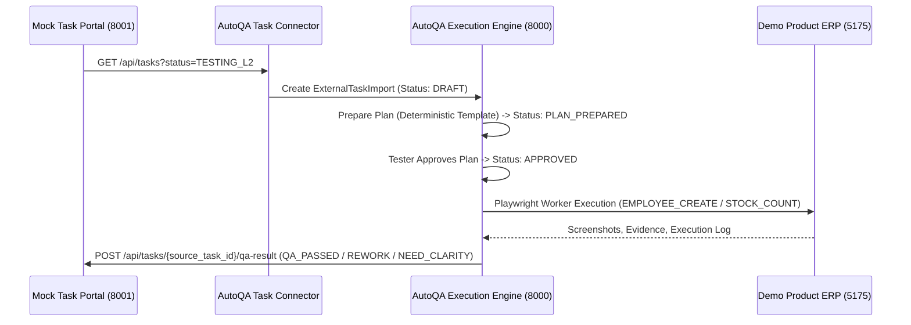

# Phase 3 — Mock Task Connector & Demo Product Execution Integration

## Overview

Phase 3 connects the local Mock Task Portal (`http://localhost:8001`), AutoQA Execution Platform (`http://localhost:8000`), and local Demo Product Website (`http://localhost:5175`). Tasks in `TESTING_L2` status are imported into AutoQA, compiled into deterministic Playwright execution plans, approved by testers, executed in a real browser against the Demo Product Website, and status callbacks (`QA_PASSED` / `REWORK` / `NEED_CLARITY`) are posted back to the Mock Task Portal.

> [!IMPORTANT]
> **Production Safety & Zero-Trust Isolation**:
> - No company URLs, Task Planners, databases, credentials, or employee data were accessed.
> - Execution runs exclusively on localhost:
>   - AutoQA Backend: `http://localhost:8000`
>   - Mock Task Portal Backend: `http://localhost:8001`
>   - Demo Product Website Backend: `http://localhost:8002`
>   - Demo Product Website Frontend: `http://localhost:5175`
> - Data model enforces immutable task revisions (`project_id + source_system + source_task_id + source_revision`).
> - Developers are strictly prevented from self-approving their own tasks.

---

## Architecture & Integration Flow

---

## Component Implementation Summary

### 1. Connector Abstraction (`backend/app/connectors/`)

- [base.py](file:///D:/AUTO_QA_TESTING/backend/app/connectors/base.py): Abstract base class `BaseTaskConnector` defining `health_check()`, `fetch_testing_l2_tasks()`, `fetch_task()`, and `send_qa_result()`.
- [mock_task_portal.py](file:///D:/AUTO_QA_TESTING/backend/app/connectors/mock_task_portal.py): `MockTaskPortalConnector` implementation targeting `http://localhost:8001` with configurable timeouts and HTTP error handling.

### 2. External Task Import Model & Storage (`backend/app/models/external_task_import.py`)

- Unique constraint: `project_id + source_system + source_task_id + source_revision`
- Immutability: New revisions generate new records without overwriting historical run evidence.
- Tracking fields: `import_status` (`DRAFT`, `PLAN_PREPARED`, `APPROVED`, `RUNNING`, `COMPLETED`, `NEED_CLARITY`), `template_type`, `approved_by`, `approved_at`, `linked_test_plan_id`, `linked_run_id`, `callback_status`, `callback_error`.

### 3. Extended Playwright Actions (`qa/automated-execution-runner.mjs` & `backend/app/services/automated_execution.py`)

Extended the execution engine to support 8 new Playwright actions:

1. `SELECT`: Select option in dropdown element.
2. `CHECK`: Check checkbox element.
3. `UNCHECK`: Uncheck checkbox element.
4. `WAIT_FOR_ELEMENT`: Wait for element visibility/presence.
5. `ASSERT_VALUE`: Assert input or element text value matches expected.
6. `ASSERT_URL`: Assert current page URL matches expected path.
7. `READ_TEXT`: Read text content from page element.
8. `ASSERT_TABLE_ROW`: Assert table row contains expected text.

### 4. Deterministic Plan Templates

- `EMPLOYEE_CREATE`: Login as HR user -> navigate `/hr/employees/new` -> fill employee details -> select department -> check active -> save -> assert table row & screenshot.
- `STOCK_COUNT`: Login as Inventory user -> navigate `/inventory/stock-count` -> select product -> read current qty -> fill counted qty -> assert diff -> submit -> assert history row & screenshot.

### 5. Developer Self-Approval Protection

- `task_import_service.py` verifies that `assigned_developer` username does not match the approver's username (`HTTP 403 Forbidden` if self-approval is attempted).

### 6. Frontend UI (`frontend/src/components/TaskImportsCore.tsx`)

- Task Import management panel added to AutoQA Dashboard.
- Provides `🔄 Sync TESTING_L2 Tasks` button, status filter, plan preview, approval trigger, execution trigger, and callback status banners.

---

## Verification Results

### 1. Pytest Backend Test Suite (`backend/tests/test_connectors.py` & `backend/tests/test_phase3_actions.py`)

- **17 test cases passed (100% success)**:
  - Connector health check & task fetching
  - Import creation & duplicate prevention
  - Template classification (`EMPLOYEE_CREATE`, `STOCK_COUNT`, `UNSUPPORTED`)
  - Plan preparation & tester approval
  - Developer self-approval blocking
  - All 8 new Playwright actions parsing & validation

### 2. Frontend TypeScript Build (`frontend/`)

- `npm run build` passed: 65 modules transformed, 0 TypeScript errors.

### 3. Playwright E2E Integration Suite (`qa/tests/phase3-task-connector.spec.ts`)

- **3 end-to-end tests passed cleanly (13.0s)**:
  - `01 — Mock Task Portal has TESTING_L2 task ready for AutoQA` PASSED
  - `02 — Sync TESTING_L2 tasks via AutoQA API` PASSED
  - `03 — Prepare plan, approve, and execute task via AutoQA API` PASSED
