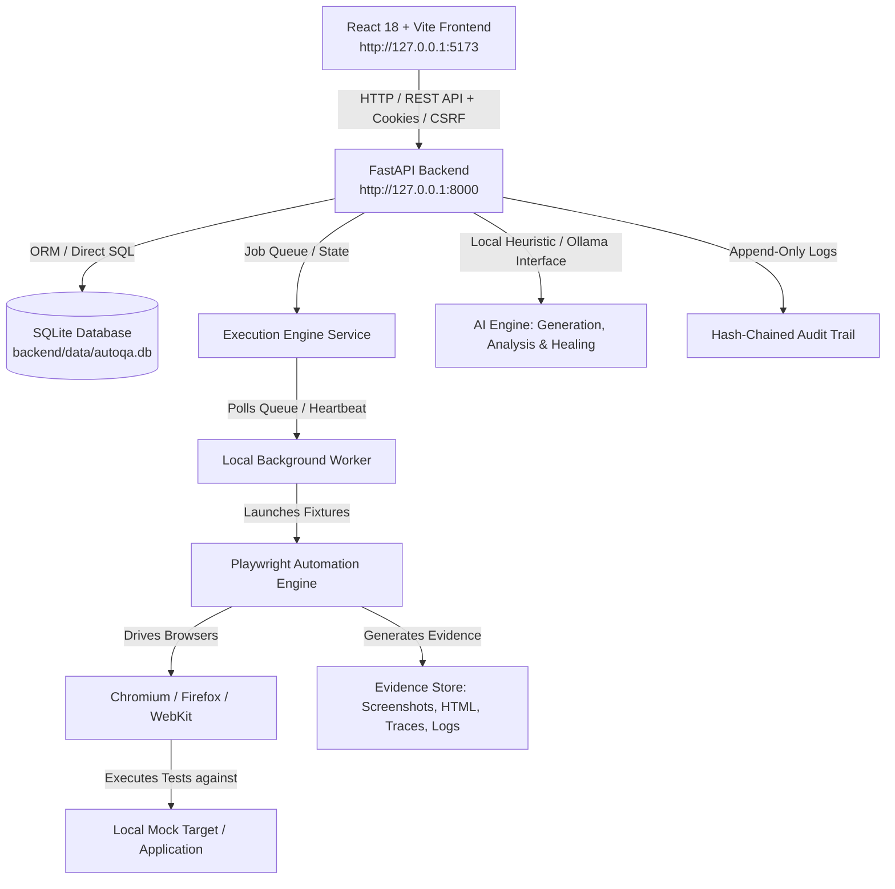

# iFive AutoQA — Exact Full End-to-End System Flow Guide

## 1. System Architecture Overview



---

## 2. Complete End-to-End Step-by-Step Flow

### Step 1: System Bootstrap & Health Check Flow
1. **Database Migration**: `run_migrations.ps1` runs SQLite schema migrations (`backend/app/migrations.py`), setting up tables for operators, sessions, projects, suites, cases, runs, defects, and audit logs.
2. **Service Launch**: `start_local_system.ps1` boots:
   - Backend FastAPI server on `127.0.0.1:8000`
   - Frontend static server/Vite preview on `127.0.0.1:5173`
   - Background worker process for test execution.
3. **Health Verification**: `verify_health.ps1` calls `GET /health` to confirm database connectivity, migration freshness, worker heartbeat, and Chromium browser binary availability.

### Step 2: Authentication & RBAC Enforcement Flow
1. **Operator Bootstrap**: Operators are created via `scripts\create_local_operator.ps1`.
2. **Session Security**:
   - Secure HTTP-only cookies + anti-CSRF tokens.
   - Force password change on initial login if temporary password was issued.
3. **Role-Based Access Control (RBAC)**:
   - **ADMIN**: Operator management, session revocation, security audit review.
   - **APPROVER**: Reviews and approves test cases, connection targets, and run executions. Cannot approve self-created items.
   - **TESTER**: Authors test cases, configures steps, executes manual/automated runs, triages defects.
   - **VIEWER**: Read-only access across all pages; form controls and mutation buttons are disabled.

### Step 3: Project & Test Case Authoring Flow
1. **Hierarchy Creation**: Project -> Module -> Test Suite -> Test Case.
2. **Step Definition**: Each test case contains structured steps:
   - Action types: `NAVIGATE`, `CLICK`, `FILL`, `ASSERT_TEXT`, `ASSERT_ELEMENT`, `WAIT`.
   - Selector strategies: CSS selectors, Text matchers, XPath, ID matchers.
3. **Draft Status**: Newly created cases start in `DRAFT` state.

### Step 4: AI-Assisted Test Generation Flow
1. **Requirement / Task Input**: Input prompt or select a mock company task from Task Connector.
2. **AI Generation Engine**: Local AI engine (`backend/app/ai/test_generation_v3.py`) parses inputs and auto-generates test scenarios.
3. **Draft Case Output**: AI creates structured test steps in `DRAFT` state.
4. **Human Review Guardrail**: No AI-generated test can execute without human review and approval.

### Step 5: Dual-Control Approval & Version Freezing Flow
1. **Submission**: Creator submits test case for review (`SUBMITTED_FOR_REVIEW`).
2. **Dual-Control Check**: Approver must be a different operator than Creator (`creator_id != approver_id`). Self-approval is rejected by backend.
3. **Approval & Snapshot**: Upon approval, the backend creates an immutable frozen snapshot version of the test case steps (`APPROVED` status, version lock).

### Step 6: Target Host Approval & SSRF Guardrail Flow
1. **Local Target Registry**: Register mock connection targets (e.g. `http://127.0.0.1:3000`).
2. **SSRF Safeguards**:
   - Only approved local loopback / internal mock targets allowed.
   - Strict protocol, host, and port filtering.
   - Separate approval required for target execution eligibility.

### Step 7: Execution Engine & Evidence Capture Flow
1. **Run Trigger**: User selects approved test case + approved target and triggers an automated run (`QUEUED`).
2. **Worker Pickup**: Worker picks up job from SQLite queue, updates status to `RUNNING`, and emits periodic heartbeats.
3. **Playwright Execution**:
   - Launches headless browser (Chromium/Firefox/WebKit).
   - Executes step by step, taking DOM snapshots and screenshot evidence.
4. **Artifact Generation**:
   - **Pass/Fail Breakdown**: Detailed step status.
   - **Evidence Files**: Screenshots, HTML DOM dumps, Playwright trace files (`trace.zip`), `stdout`/`stderr` logs.

### Step 8: Failure Analysis, Auto-Healing & Defect Flow
1. **Root Cause Analysis**: AI engine inspects failed step stack traces and DOM snapshots.
2. **Self-Healing Suggestions**: AI proposes updated CSS selectors or step fixes.
3. **Defect Auto-Creation / Triage**:
   - Failed runs prompt defect creation with pre-populated evidence links.
   - Triaging flow: `NEW` -> `UNDER_INVESTIGATION` -> `ASSIGNED` -> `FIXED` -> `RETESTED` -> `CLOSED`.

### Step 9: Quality Reporting & Neutralized Export Flow
1. **Dashboard Metrics**: Quality score, pass/fail trends, execution time distribution, defect severity breakdown.
2. **Neutralized Export**: CSV / JSON export auto-escapes formula injection characters (`=`, `+`, `-`, `@`) to prevent spreadsheet exploitation.
3. **Audit Trail**: Every critical action is recorded in an append-only, SHA-256 hash-chained security log.

---

## 3. PowerShell Commands to Execute Full Flow

### A. Environment Initialization
```powershell
# 1. Apply database migrations
powershell -NoProfile -ExecutionPolicy Bypass -File .\scripts\run_migrations.ps1

# 2. Build frontend (if needed)
cd frontend
npm.cmd run build
cd ..

# 3. Start local backend, frontend, and execution worker
powershell -NoProfile -ExecutionPolicy Bypass -File .\scripts\start_local_system.ps1

# 4. Verify system health
powershell -NoProfile -ExecutionPolicy Bypass -File .\scripts\verify_health.ps1
```

### B. Automated Verification Suite Execution
```powershell
# Run the entire isolated Playwright end-to-end verification pack
powershell -NoProfile -ExecutionPolicy Bypass -File .\scripts\run_tests.ps1
```

### C. System Teardown
```powershell
# Stop all running background processes safely
powershell -NoProfile -ExecutionPolicy Bypass -File .\scripts\stop_local_system.ps1
```
