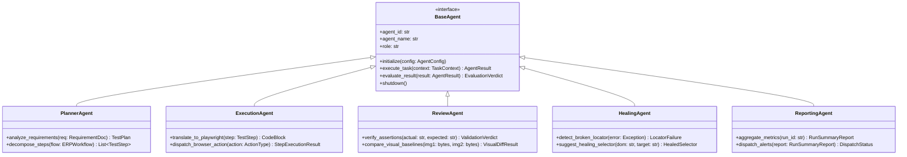

# Version 2.0 AI Agent Framework Specification

**Platform Name**: iFive AutoQA X Enterprise AI Engineering Platform  
**Target Version**: Version 2.0 (Phases 17 – 20)  
**Architect**: Principal Software Architect & AI Agent Lead  
**Date**: 2026-08-03  
**Status**: 📐 **AGENT INTERFACE DESIGN SPECIFICATION**  

---

## 1. Executive Summary

The **AI Agent Framework** provides a standardized, event-driven interface for all autonomous and specialized AI agents in Version 2.0. The framework defines abstract agent contracts, memory channels, decision loops, and telemetry hooks without baking in fixed business logic.

---

## 2. Core Agent Hierarchy & Interfaces



---

## 3. Detailed Agent Interface Definitions

### 1. `BaseAgent` (Core Abstraction)

```python
from abc import ABC, abstractmethod
from typing import Dict, Any, Optional

class BaseAgent(ABC):
    @abstractmethod
    def initialize(self, config: Dict[str, Any]) -> bool:
        """Initialize agent memory, tools, and connections."""
        pass

    @abstractmethod
    def execute_task(self, context: Dict[str, Any]) -> Dict[str, Any]:
        """Perform autonomous task execution."""
        pass

    @abstractmethod
    def evaluate_result(self, result: Dict[str, Any]) -> Dict[str, Any]:
        """Evaluate task execution verdict and confidence score."""
        pass

    @abstractmethod
    def shutdown(self) -> None:
        """Clean up agent resources and persist final state."""
        pass
```

### 2. `PlannerAgent` (Test Generation & Strategy)

- Contract: Receives high-level user stories or ERP task specs; produces structured `TestPlan` JSON containing ordered `TestCases` and selectors.

### 3. `ExecutionAgent` (Playwright Driver Bridge)

- Contract: Consumes `TestCases`; emits Playwright actions (`NAVIGATE`, `FILL`, `CLICK`, `ASSERT_TEXT`); captures screenshots and trace buffers.

### 4. `ReviewAgent` (Quality Verification)

- Contract: Inspects execution logs, HTTP responses, visual diffs, and database records; determines final step status (`PASSED`, `FAILED`, `BLOCKED`).

### 5. `HealingAgent` (Self-Healing Interceptor)

- Contract: Triggered on locator failure; analyzes HTML DOM hierarchy; generates healed CSS/XPath selectors and updates memory graph.

### 6. `ReportingAgent` (Intelligence Summarization)

- Contract: Aggregates test run results; invokes AI Copilot analysis; generates PDF/HTML executive reports and dispatches notifications.

---

## 4. Verification Verdict

**AI Agent Framework Verdict**: 📐 **SPECIFICATION COMPLETE** — Standardized agent contracts defined for seamless Version 2.0 integration.
