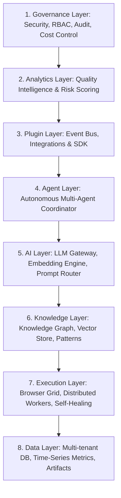

# Version 2.0 AI Engineering Platform Architecture Specification

**Platform Name**: iFive AutoQA X Enterprise AI Engineering Platform  
**Target Version**: Version 2.0 (Phases 17 – 20)  
**Architect**: Principal Software Architect & Enterprise AI Platform Engineer  
**Date**: 2026-08-03  
**Status**: 📐 **ARCHITECTURAL DESIGN SPECIFICATION**  

---

## 1. Executive Summary

Version 2.0 transforms **iFive AutoQA X** from an automated QA tool into an **Autonomous AI Software Engineering & Quality Intelligence Platform**. The architecture introduces an 8-layer additive foundation built on top of the frozen Version 1.0 baseline.

---

## 2. High-Level 8-Layer Architectural Blueprint

---

## 3. Detailed Layer Specifications

### 1. Governance Layer

- **Enterprise RBAC & Identity**: Extends v1.0 6-role model with Organization-level & Team-level granular permissions.
- **Audit Log Pipeline**: Immutable append-only audit event streaming for all AI decisions and execution triggers.
- **Cost & Token Management**: Budget quotas, token usage monitoring, model rate limits.

### 2. Analytics Layer

- **Quality Intelligence Platform (SQIP)**: Real-time defect trends, pass rate velocity, test coverage heatmaps.
- **Predictive Quality Risk Scoring**: Machine learning model forecasting release readiness score (0-100).
- **Executive Quality Dashboards**: Real-time business KPI visualization.

### 3. Plugin Layer

- **Event-Driven Plugin SDK**: Hook system (`on_task_create`, `on_execution_complete`, `on_defect_raise`).
- **Integrations Engine**: Bi-directional connectors for Jira, Azure DevOps, GitHub, GitLab, Slack, Teams, Email, SAP, Salesforce.
- **Plugin Sandbox**: Isolated execution context with restricted API tokens and rate limits.

### 4. Agent Layer

- **Multi-Agent Orchestrator**: Coordinates 13+ specialized AI agents via asynchronous event bus.
- **Agent State Machine**: Persistent state transitions (`IDLE` -> `PLANNING` -> `EXECUTING` -> `REVIEWING` -> `HEALED`).
- **Task Decomposition Engine**: Splits high-level ERP requirements into atomic Playwright test steps.

### 5. AI Layer

- **Model Gateway**: Abstraction layer supporting Local LLMs (Ollama/vLLM) and Cloud LLMs (Gemini/OpenAI/Anthropic).
- **Prompt Router**: Dynamic prompt template compiler with automatic token optimization.
- **Context Builder**: Assembles relevant code, DB schemas, past execution memory, and defect history into LLM prompt contexts.

### 6. Knowledge Layer

- **Enterprise Knowledge Graph**: Graph database mapping Companies -> Projects -> Modules -> Requirements -> Test Cases -> Defects.
- **Vector Embeddings Store**: Semantic search over test cases, bug reports, and DOM selectors.
- **Test Pattern Library**: Reusable ERP workflows (Auth, Sales, Purchase, Inventory, Finance).

### 7. Execution Layer

- **Distributed Browser Grid**: Scalable Playwright Chromium worker pool supporting parallel containerized execution.
- **Real-Time Self-Healing Interceptor**: Detects broken DOM selectors during live execution and applies dynamic locator recovery.
- **Artifact Pipeline**: Automatic recording of WebP videos, trace zips, DOM snapshots, and network HAR files.

### 8. Data Layer

- **Multi-Tenant Database Engine**: PostgreSQL / SQLite hybrid architecture with row-level security.
- **Time-Series Metric Store**: Execution latency, step duration, memory utilization.
- **Artifact Blob Storage**: Secure S3/Local file store for video recordings, screenshots, and HTML snapshots.

---

## 4. Verification Verdict

**Architecture V2 Verdict**: 📐 **SPECIFICATION COMPLETE** — 8-layer architecture designed in full alignment with additive Version 2.0 principles.
