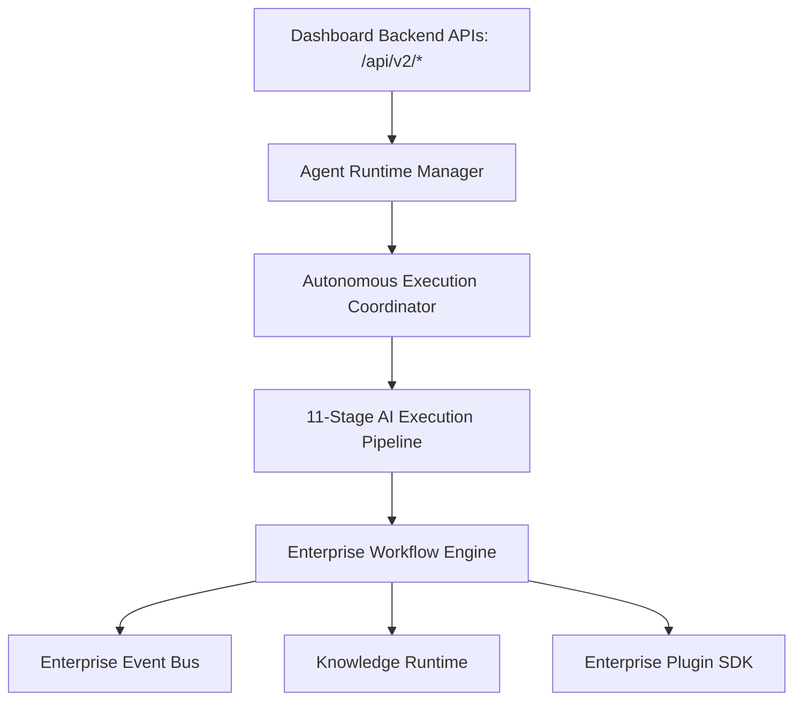

# Phase 17.4 Autonomous Platform Architecture Manual

**Platform**: iFive AutoQA X Enterprise AI Engineering Platform  
**Target Package**: `backend/app/v2/`  
**Date**: 2026-08-03  

---

## 1. Executive Summary

Phase 17.4 integrates every AI subsystem created across Phase 17.1 (Foundation), Phase 17.2 (AI Agents), and Phase 17.3 (Reasoning & Decision Engine) into a single enterprise autonomous platform.

---

## 2. Integrated Platform Layer Architecture

