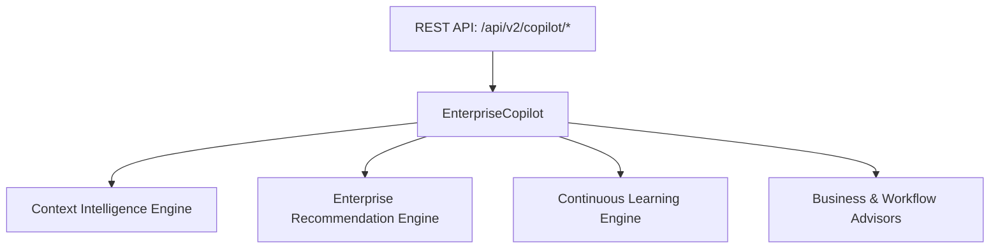

# Phase 17.5 Enterprise AI Copilot Architecture Manual

**Platform**: iFive AutoQA X Enterprise AI Engineering Platform  
**Target Package**: `backend/app/v2/copilot/`  
**Date**: 2026-08-03  

---

## 1. Executive Summary

The Enterprise AI Copilot Architecture connects session management, context resolution, recommendation generation, continuous learning, and multi-turn conversational assistance.

---

## 2. Component Architecture

