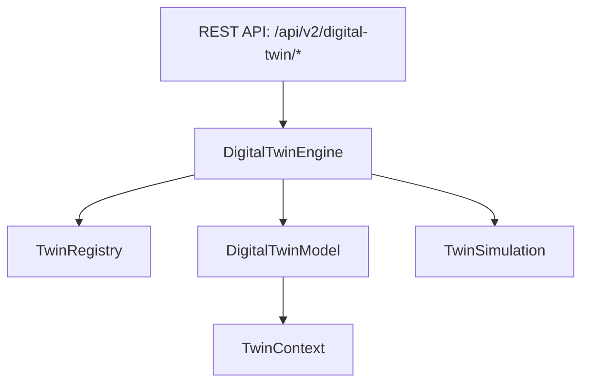

# Phase 19 Enterprise Digital Twin Engine Manual

**Platform**: iFive AutoQA X Enterprise AI Engineering Platform (Version 2.1)  
**Target Package**: `backend/app/v2/digital_twin/`  
**Date**: 2026-08-03  

---

## 1. Executive Summary

The Enterprise Digital Twin Engine provides point-in-time system state modeling (`DigitalTwinModel`, `TwinContext`), scenario simulation (`TwinScenario`), state variance comparison (`TwinSnapshot`), and registry lookup (`TwinRegistry`).

---

## 2. Digital Twin Architecture

