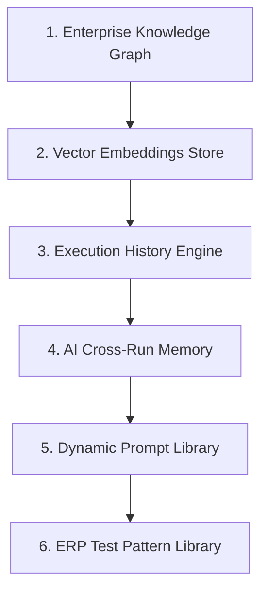

# Version 2.0 Enterprise Knowledge Platform Specification

**Platform Name**: iFive AutoQA X Enterprise AI Engineering Platform  
**Target Version**: Version 2.0 (Phases 17 – 20)  
**Architect**: Principal Knowledge Architect & AI Lead  
**Date**: 2026-08-03  
**Status**: 📐 **KNOWLEDGE PLATFORM ARCHITECTURAL SPECIFICATION**  

---

## 1. Executive Summary

The **Enterprise Knowledge Platform** serves as the central intelligence engine for Version 2.0. It unifies project domain topology, past execution history, AI memory, prompt engineering templates, and reusable ERP test patterns into a multi-tenant knowledge graph and vector search index.

---

## 2. Knowledge Subsystem Architecture

---

## 3. Subsystem Breakdown

### 1. Enterprise Knowledge Graph

- **Topology Schema**:
  - `Nodes`: `Company`, `Project`, `Module`, `Requirement`, `TestCase`, `Defect`, `Operator`, `Target`.
  - `Edges`: `OWNS_PROJECT`, `BELONGS_TO_MODULE`, `VALIDATES_REQUIREMENT`, `PRODUCED_DEFECT`, `EXECUTED_BY`.
- **Query Capabilities**: Multi-hop path analysis for change impact prediction (e.g., "Updating Sales Module impacts Inventory and Finance").

### 2. Vector Embeddings Store

- **Semantic Index**: Vector embeddings generated for all DOM element attributes, test case steps, and defect descriptions.
- **Selector Recovery**: Finds similar DOM element candidates when a locator breaks during UI automation.

### 3. Execution History & Telemetry Engine

- **Cross-Run Metrics**: Tracks step duration trends, flakiness index, and failure cluster patterns over time.

### 4. AI Cross-Run Memory Service

- **Memory Types**:
  - `Short-Term`: Per-execution run state and active DOM context.
  - `Long-Term`: Persistent best-performing CSS/XPath locators and self-healing fixes.

### 5. Dynamic Prompt Library

- **Template Versioning**: Version-controlled system prompts for test generation, bug analysis, and risk scoring.
- **Dynamic Parameter Injection**: Interpolates runtime context (`{requirement}`, `{dom_snippet}`, `{error_trace}`).

### 6. ERP Test Pattern Library

- **Curated Workflow Templates**:
  - `Auth Pattern`: Login, Session Restore, Role Switching.
  - `Sales Pattern`: Sales Order Creation, Dual-Control Approval, Print Preview.
  - `Purchase Pattern`: Purchase Order, Goods Receipt, PO Invoice.
  - `Inventory Pattern`: Stock In, Stock Transfer, Valuation.
  - `Finance Pattern`: Customer Invoice, Cash Receipt, Ledger Balance.

---

## 4. Verification Verdict

**Knowledge Platform Verdict**: 📐 **SPECIFICATION COMPLETE** — Multi-tenant Knowledge Graph, AI Memory, and Pattern Library designed for Version 2.0.
