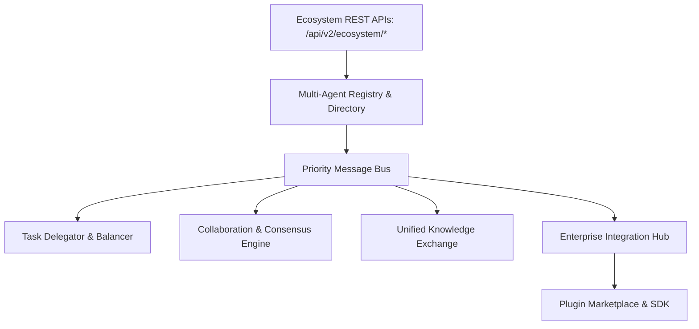

# Phase 18 Multi-Agent Architecture Manual

**Platform**: iFive AutoQA X Enterprise AI Engineering Platform (Version 2.1)  
**Target Package**: `backend/app/v2/ecosystem/`  
**Date**: 2026-08-03  

---

## 1. Executive Summary

Phase 18 transforms the platform into an Enterprise Multi-Agent Ecosystem where specialized AI agents coordinate, communicate over an asynchronous priority Message Bus, negotiate parameters, delegate tasks, and execute complex ERP workflows.

---

## 2. Ecosystem Architecture

