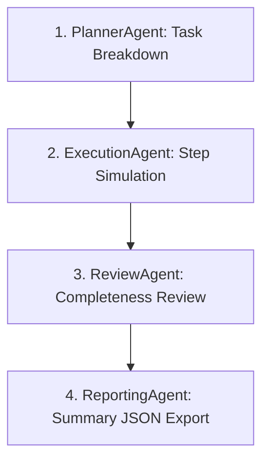

# Phase 17.2 Agent Orchestrator Specifications

**Platform**: iFive AutoQA X Enterprise AI Engineering Platform  
**Target Class**: `app.v2.workflows.engine.AgentOrchestrator`  
**Date**: 2026-08-03  

---

## 1. Executive Summary

The `AgentOrchestrator` acts as the central coordinator for Phase 17.2. It manages agent registrations, loads agent instances, constructs multi-step workflow pipelines, routes message contexts, and retries failed steps.

---

## 2. Default QA Pipeline Workflow

---

## 3. Orchestration Capabilities

- `register_agent(agent_id, agent_cls)`: Dynamically registers new v2 agents into the registry.
- `list_agents()`: Returns list of registered agent identifiers.
- `execute_full_qa_pipeline(project_id, task_description)`: Constructs and executes the 4-stage autonomous QA pipeline.
