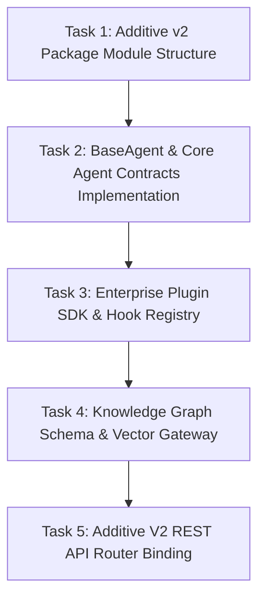

# Phase 17 Technical Implementation Plan

**Platform Name**: iFive AutoQA X Enterprise AI Engineering Platform  
**Target Version**: Version 2.0 (Phase 17)  
**Lead Engineer**: Principal Software Architect & DevOps Lead  
**Date**: 2026-08-03  
**Status**: 📋 **TECHNICAL EXECUTION PLAN**  

---

## 1. Executive Overview

This technical implementation plan specifies the exact engineering steps to begin code construction for **Phase 17 – AI Engineering Platform Foundation**. All construction will occur in a dedicated additive directory (`backend/app/v2/`) to ensure complete isolation from frozen Version 1.0 code.

---

## 2. Engineering Tasks & Component Roadmap

---

## 3. Component Construction Specifications

### Task 1: Additive Package Structure (`backend/app/v2/`)

- Create new Python package `backend/app/v2/` with sub-packages:
  - `app/v2/agents/` (Agent implementations)
  - `app/v2/plugins/` (Plugin SDK & hooks)
  - `app/v2/knowledge/` (Knowledge graph & memory)
  - `app/v2/api/` (Version 2.0 endpoints under `/api/v2/*`)

### Task 2: Abstract Agent Framework Implementation

- Construct `BaseAgent` class and `AgentRegistryV2` in `app/v2/agents/base.py`.
- Implement `PlannerAgent`, `ExecutionAgent`, `ReviewAgent`, `HealingAgent`, `ReportingAgent` class skeletons with strict typing and Pydantic contexts.

### Task 3: Enterprise Plugin SDK & Event Bus

- Construct `BasePlugin` class and `PluginManager` in `app/v2/plugins/sdk.py`.
- Implement event subscriber registry (`on_task_create`, `on_defect_raise`, `on_run_complete`).

### Task 4: Knowledge Graph & Vector Gateway

- Construct Knowledge Graph SQLAlchemy ORM models in `app/v2/knowledge/models.py`.
- Add vector embedding gateway interface for semantic selector lookup.

### Task 5: Additive V2 Router Integration

- Register `/api/v2` router group in `app/main.py` without modifying existing v1 `/api/*` endpoints.

---

## 4. Verification & Testing Strategy

1. **Isolation Check**: Verify `pytest` runs across all 192 v1.0 tests with zero regressions.
2. **v2 Component Tests**: Add new test suite in `backend/tests/v2/` testing Phase 17 agent contracts and plugin hooks.
3. **API Introspection**: Verify `/api/v2/health` returns Version 2.0 system state alongside v1.0 `/api/health`.

---

## 5. Verification Verdict

**Phase 17 Implementation Plan Verdict**: 📋 **READY FOR CODING** — Technical implementation plan finalized.
