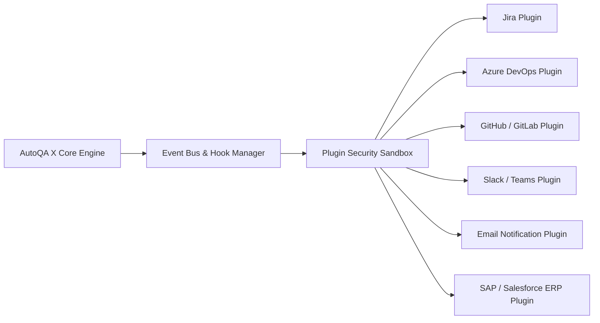

# Version 2.0 Enterprise Plugin Architecture Specification

**Platform Name**: iFive AutoQA X Enterprise AI Engineering Platform  
**Target Version**: Version 2.0 (Phases 17 – 20)  
**Architect**: Principal Enterprise Architect & Integration Lead  
**Date**: 2026-08-03  
**Status**: 📐 **PLUGIN SDK ARCHITECTURAL SPECIFICATION**  

---

## 1. Executive Summary

The **Enterprise Plugin Architecture** defines an extensible SDK and event bus enabling third-party and custom enterprise integrations. The architecture allows seamless bi-directional synchronization with issue trackers, CI/CD tools, communication platforms, and enterprise ERP systems without altering core platform code.

---

## 2. Plugin Ecosystem Blueprint



---

## 3. Targeted Enterprise Connectors

| Plugin Target | Integration Category | Trigger Events | Action Capabilities |
| :--- | :--- | :--- | :--- |
| **Jira** | Issue Tracking | `on_task_create`, `on_defect_raise` | Sync user stories, auto-create Jira bugs, update task status |
| **Azure DevOps** | ALM / CI/CD | `on_pipeline_trigger` | Fetch backlog items, update work item status, log test runs |
| **GitHub / GitLab** | Code Repository | `on_pr_open`, `on_commit` | Run automated QA on PRs, post inline PR review comments |
| **Slack / Teams** | Collaboration | `on_run_complete`, `on_failure` | Send interactive block-kit alerts, dispatch daily QA summaries |
| **Email** | Notifications | `on_release_verdict` | Dispatch HTML release certificates & executive summary PDFs |
| **SAP / Salesforce** | Enterprise ERP | `on_erp_flow_start` | Inject synthetic test master data, validate invoice ledger postings |

---

## 4. Plugin SDK Contract Specification

### `BasePlugin` Interface Definition

```python
from abc import ABC, abstractmethod
from typing import Dict, Any, List

class BasePlugin(ABC):
    @property
    @abstractmethod
    def plugin_id(self) -> str:
        """Unique identifier (e.g. 'org.ifive.jira_connector')."""
        pass

    @property
    @abstractmethod
    def supported_events(self) -> List[str]:
        """Events listened to (e.g. ['on_defect_raise', 'on_run_complete'])."""
        pass

    @abstractmethod
    def initialize(self, config: Dict[str, Any]) -> bool:
        """Initialize authentication & connection parameters."""
        pass

    @abstractmethod
    def handle_event(self, event_name: str, payload: Dict[str, Any]) -> Dict[str, Any]:
        """Process incoming platform event payload."""
        pass

    @abstractmethod
    def health_check(self) -> Dict[str, Any]:
        """Verify target service connectivity."""
        pass
```

---

## 5. Verification Verdict

**Plugin Architecture Verdict**: 📐 **SPECIFICATION COMPLETE** — Enterprise Plugin SDK specified with zero modifications to Version 1.0 production baseline.
