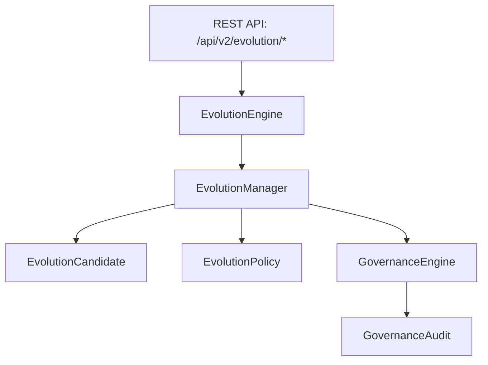

# Phase 20 Self-Evolution Architecture Manual

**Platform**: iFive AutoQA X Enterprise AI Engineering Platform (Version 3.0)  
**Target Package**: `backend/app/v2/evolution/`  
**Date**: 2026-08-03  

---

## 1. Executive Summary

The Self-Evolution Architecture enables AutoQA to continuously learn, adapt, and refine its capabilities (`EvolutionEngine`, `EvolutionCandidate`, `EvolutionCycle`) under strict human and automated governance (`GovernanceEngine`).

---

## 2. Platform Self-Evolution Flow

