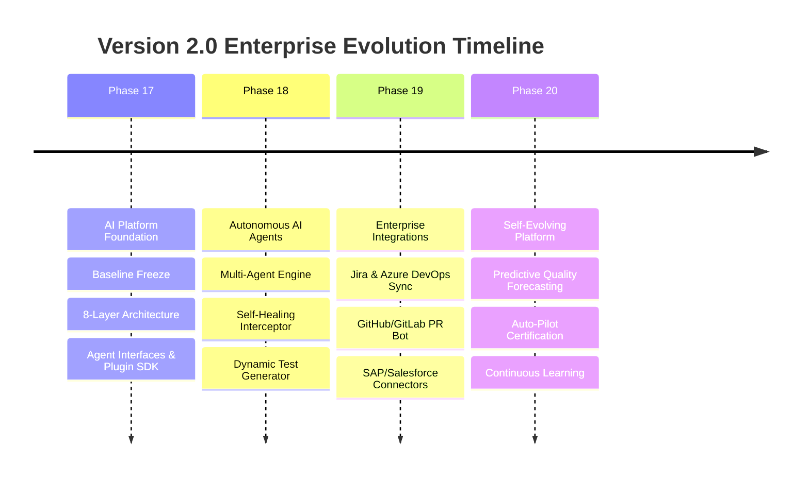

# Version 2.0 Enterprise Roadmap Specification (Phases 17 – 20)

**Platform Name**: iFive AutoQA X Enterprise AI Engineering Platform  
**Target Horizon**: Version 2.0  
**Architect**: Principal Software Architect & DevOps Lead  
**Date**: 2026-08-03  
**Status**: 🚀 **ENTERPRISE ROADMAP SPECIFICATION**  

---

## 1. Executive Summary

The Version 2.0 Roadmap defines the strategic evolution of **iFive AutoQA X** across four major engineering phases (Phases 17 – 20). Building upon the frozen Version 1.0 General Availability baseline, each phase introduces modular, additive capabilities.

---

## 2. Phase 17 – 20 Roadmap Blueprint

---

## 3. Phase-by-Phase Milestone Breakdown

### Phase 17 — AI Platform Foundation

- **Focus**: Baseline freeze, 8-layer architecture specification, agent contracts, plugin SDK, knowledge platform design, and implementation planning.
- **Deliverables**: Complete architectural specifications in `docs/v2/`.
- **Status**: 🟢 **DESIGN COMPLETE & READY FOR IMPLEMENTATION**

### Phase 18 — Autonomous AI Agent Framework

- **Focus**: Concrete python implementation of `BaseAgent`, `PlannerAgent`, `ExecutionAgent`, `ReviewAgent`, `HealingAgent`, and `ReportingAgent`.
- **Deliverables**: Asynchronous agent event bus, real-time DOM self-healing interceptor, multi-agent pipeline orchestrator.

### Phase 19 — Multi-System Enterprise Integration

- **Focus**: Bi-directional integration plugins for Jira, Azure DevOps, GitHub, GitLab, Slack, Teams, Email, SAP, and Salesforce.
- **Deliverables**: Production plugin SDK, event webhook router, enterprise synthetic data generator.

### Phase 20 — Self-Evolving Autonomous QA Platform

- **Focus**: Advanced machine learning quality forecasting, automated release certification, self-tuning prompt library, and enterprise zero-code ecosystem.
- **Deliverables**: SQIP predictive quality dashboard, autonomous release gatekeeper, continuous graph evolution engine.

---

## 4. Verification Verdict

**Version 2 Roadmap Verdict**: 🚀 **ROADMAP FINALIZED** — Strategic milestone timeline for Phases 17–20 documented.
