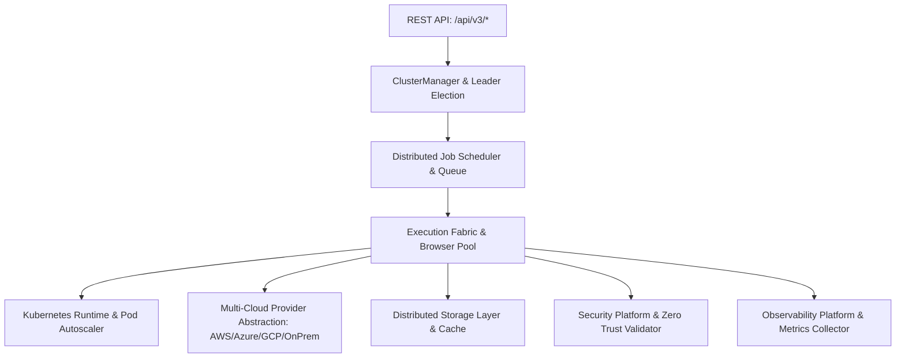

# Phase 21 Distributed Architecture Manual

**Platform**: iFive AutoQA X Distributed Enterprise QA Operating System (Version 3.1)  
**Target Package**: `backend/app/v3/`  
**Date**: 2026-08-03  

---

## 1. Executive Summary

Phase 21 constructs Version 3.1 Distributed Enterprise QA Operating System & AI Infrastructure, enabling horizontal scalability, multi-node agent clustering, distributed job scheduling, Kubernetes pod autoscaling, zero-trust security, and multi-cloud runtime support.

---

## 2. Distributed Platform Architecture

