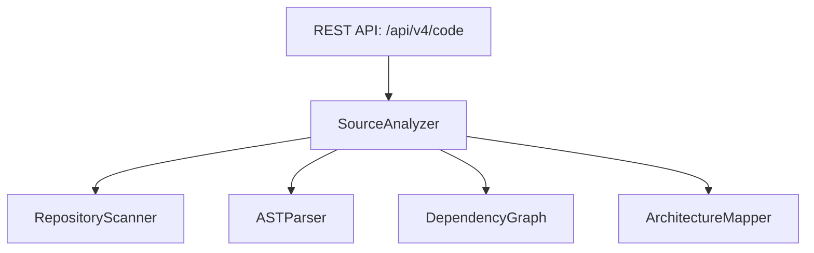

# Phase 22 Source Code Intelligence Engine Manual

**Platform**: iFive AutoQA X Autonomous Software Engineering Platform (Version 4.0)  
**Target Package**: `backend/app/v4/code/`  
**Date**: 2026-08-03  

---

## 1. Executive Summary

`SourceAnalyzer` provides multi-language repository scanning (`RepositoryScanner`), AST syntax tree parsing (`ASTParser`), dependency graph construction (`DependencyGraph`), and full architecture mapping (`ArchitectureMapper`).

---

## 2. Code Intelligence Architecture

