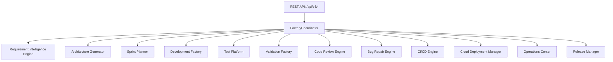

# Phase 23 Autonomous Enterprise Software Factory Manual

**Platform**: iFive AutoQA X Autonomous Enterprise Software Factory (Version 5.0)  
**Target Package**: `backend/app/v5/`  
**Date**: 2026-08-03  

---

## 1. Executive Summary

Phase 23 constructs Version 5.0 Autonomous Enterprise Software Factory, enabling zero-human-touch software engineering execution across a 12-stage lifecycle: Requirements -> Architecture -> Planning -> Development -> Testing -> Validation -> Review -> Repair -> CI/CD -> Deployment -> Monitoring -> Optimization (`FactoryCoordinator`).

---

## 2. Software Factory Pipeline Flow

