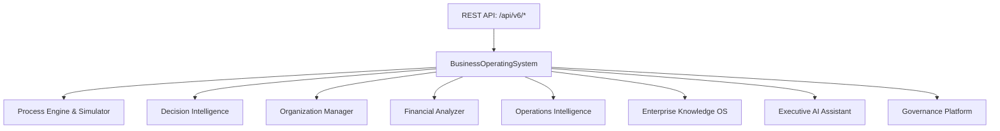

# Phase 24 Enterprise Business Operating System Manual

**Platform**: iFive AutoQA X Autonomous Digital Enterprise & AI Business OS (Version 6.0)  
**Target Package**: `backend/app/v6/business/`  
**Date**: 2026-08-03  

---

## 1. Executive Summary

Phase 24 constructs Version 6.0 Autonomous Digital Enterprise & AI Business OS, driving enterprise operation from Business Goals -> Requirements -> Architecture -> Development -> Testing -> Deployment -> Operations -> Business Intelligence -> Governance -> Continuous Optimization (`BusinessOperatingSystem`).

---

## 2. Digital Enterprise Architecture

