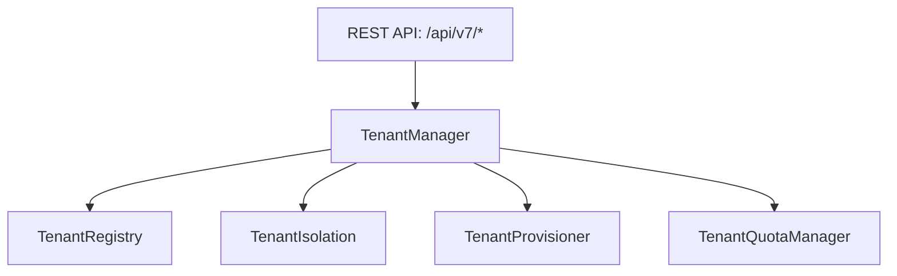

# Phase 25 Multi-Tenant Platform Manual

**Platform**: iFive AutoQA X Global Autonomous AI Enterprise Cloud & Marketplace Platform (Version 7.0)  
**Target Package**: `backend/app/v7/tenant/`  
**Date**: 2026-08-03  

---

## 1. Executive Summary

Phase 25 constructs Version 7.0 Global Multi-Tenant AI Cloud Platform, providing tenant onboarding (`TenantManager`), multi-tenant resource isolation (`TenantIsolation`), lifecycle management, and quota controls.

---

## 2. Multi-Tenant Architecture

